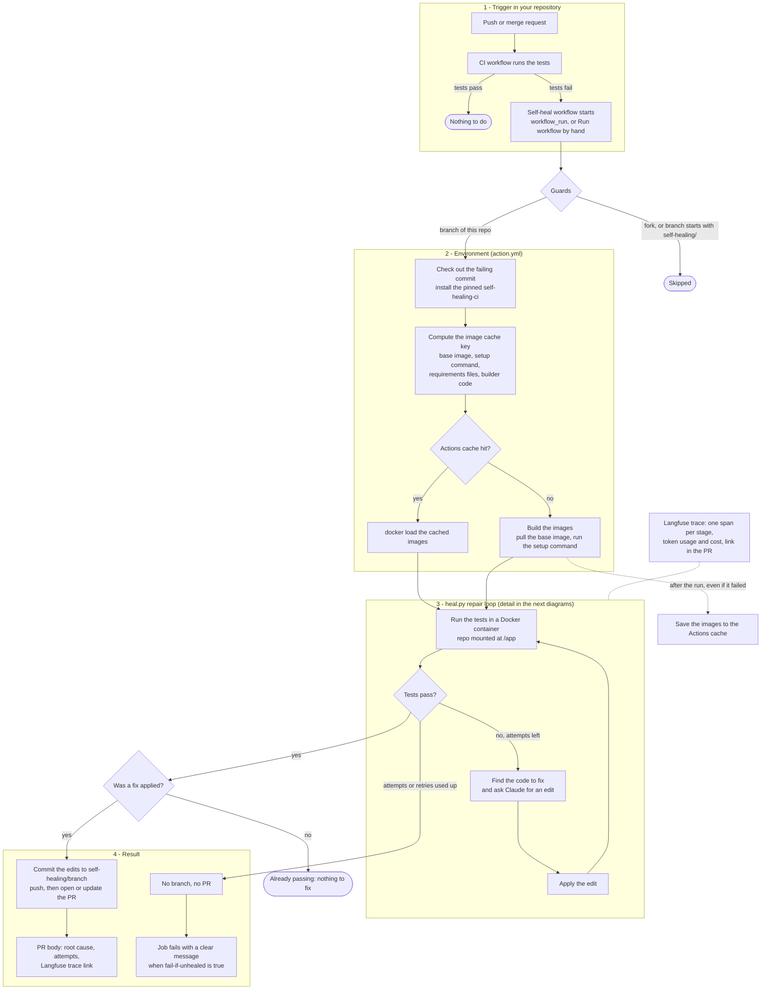
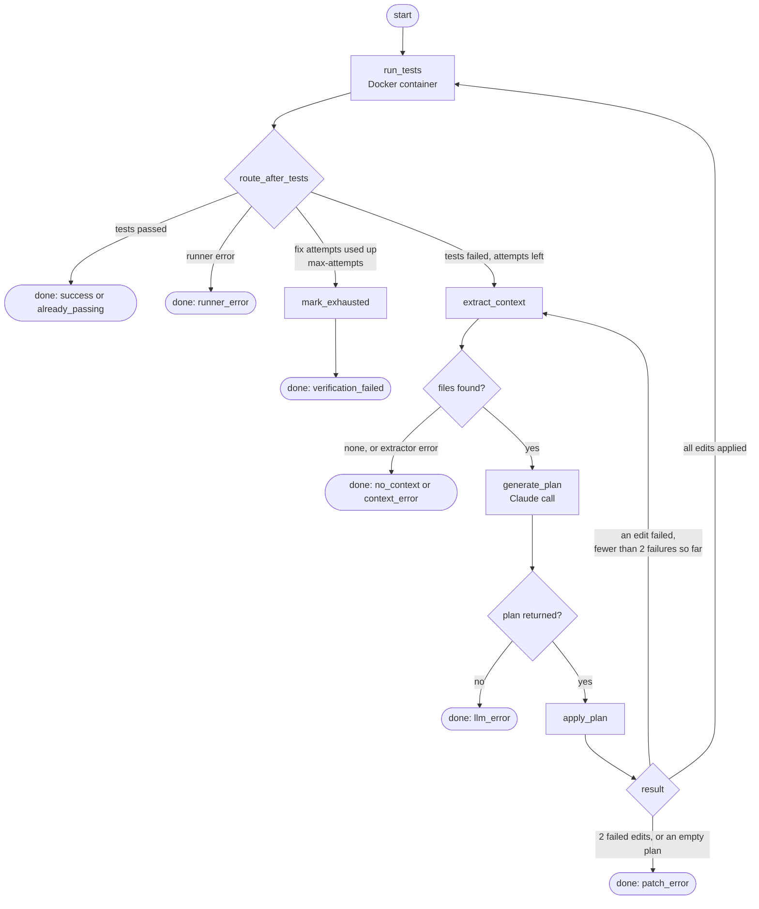
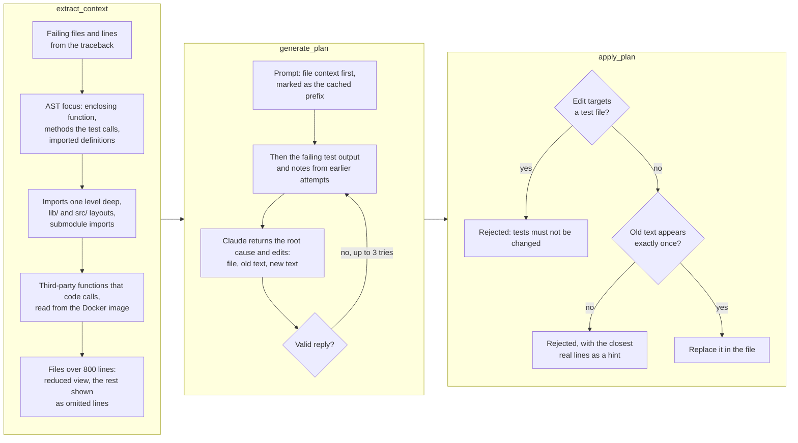

# Self-Healing CI/CD — Phase 3 (LangGraph + GitHub Action + cached Docker images)

Self-Healing CI/CD is a repo-local repair loop that turns failing test output into a verified code fix.
The project combines:

- a local CLI runner (`heal.py`)
- a LangGraph workflow (`core/workflow.py`)
- Docker-based test execution (`core/docker_runner.py`)
- AI patch generation via Anthropic
- automatic PR creation through a GitHub Action (`action.yml`)
- cached Docker environment images via `scripts/image_cache.sh` and GitHub Actions cache

The goal is simple: when CI fails, extract the failing context, ask an LLM for a patch, apply it, verify it in a fresh Docker container, and open a PR only when the fix is real.

## Why this project exists

Most failing builds still require a human to debug the test output, identify the root cause, and write a patch. This project automates that loop in a controlled way:

- it runs tests in an isolated container
- it extracts the likely failure files and surrounding context
- it asks the model for a patch plan
- it retries only a few times before stopping
- it verifies the final patch in a fresh container
- it can open a PR from GitHub Actions for the branch that failed

This keeps the repair loop focused on reproducible validation instead of blind AI edits.

## Architecture

### End-to-end: from a failing CI run to a pull request



### The repair loop (LangGraph state machine)



`core/workflow.py` builds this graph. Three limits keep it bounded:

| Limit | Value | Where |
|---|---|---|
| Fix attempts | `max-attempts` (default 3), plus one final verification run | action input or `--max-attempts` |
| Failed edits retried | 2 | `MAX_APPLY_FAILURES` in `core/workflow.py` |
| Invalid model replies retried | 3 | `MAX_TOOL_ATTEMPTS` in `core/patch_generator.py` |

### Inside `extract_context`, `generate_plan` and `apply_plan`



## How the project works end-to-end

### 1) Local CLI execution
`heal.py` is the entry point. It parses the repo path and optional flags such as:

- `--image`
- `--platform`
- `--test-cmd`
- `--setup-cmd`
- `--max-attempts`
- `--model`
- `--result-file`

It creates a `DockerTestRunner`, runs the workflow, and then writes a JSON result file if requested.

### 2) Dockerized test run
`core/docker_runner.py` does the container work:

- detects the base image automatically
- optionally bakes dependencies into a reusable image
- mounts the repo into `/app`
- runs the test command in a fresh container
- captures stdout/stderr and exit code

The dependency image is tagged as `self-heal-setup:<hash>` so it can be reused across runs.

### 3) Context extraction
`core/context_extractor.py` reads the failing test output and extracts likely relevant source files, traceback locations, and nearby file context.

### 4) Patch generation
`core/patch_generator.py` sends the failure plus context to Anthropic and asks for a structured patch plan. The patch plan is validated through Pydantic models in `core/models.py`.

### 5) Patch application
`core/patch_applier.py` applies each edit as an exact search-and-replace: the model's `old` text must appear exactly once in the target file. Edits to test files are rejected, and each applied edit leaves a `.patch` record behind for review.

### 6) Re-run and verify
The workflow loops until:

- the tests pass
- the repo is already passing
- the max attempt count is reached
- the patch cannot be applied or no context is found

## Docker image caching behavior

The project caches the prepared test environment between GitHub Action runs.

This is implemented in:

- [action.yml](action.yml)
- [scripts/image_cache.sh](scripts/image_cache.sh)
- [core/docker_runner.py](core/docker_runner.py)

The flow is:

1. compute a cache key from:
   - base image
   - setup command
   - requirements files
   - Docker runner code itself
2. restore the matching tar.gz archive from GitHub Actions cache
3. `docker load` it onto the runner
4. run the self-healing flow
5. if no cache hit, `docker save` the image(s) and save them back to cache

This avoids rebuilding dependency-heavy Docker images on every workflow run.

## Langfuse traceability and observability

The project supports optional tracing through Langfuse so every repair run is auditable.

When `LANGFUSE_PUBLIC_KEY`, `LANGFUSE_SECRET_KEY`, and `LANGFUSE_BASE_URL` are present, `heal.py` opens a trace for each run and records metadata such as:

- run status
- exit code
- performed fix attempts
- patch application failures
- file paths touched during context extraction
- model name and repo name
- final trace URL so you can inspect it in Langfuse

The trace is intentionally metadata-only. It does not dump full prompts or repository contents, and it does not log the entire test output by default; the workflow only keeps summaries and key fields needed to understand what happened.

This makes the system useful for debugging model behavior and verifying that a failed CI run was repaired by a legitimate patch rather than an accidental or silent no-op.

> Why there is no `platform` in the action command by default: the local CLI already supports `--platform`, but the composite action interface did not expose it until this fix. The action now forwards `platform` to `heal.py`, which matters for Apple Silicon hosts or projects that need `linux/amd64` compatibility.

## CI and self-healing GitHub Actions workflows

Use two workflow files. The first runs the complete test suite on pushes to `main` and on pull requests. The second listens for the `CI` workflow to finish and starts healing only when that run fails.

### 1. Run all tests: `.github/workflows/ci.yml`

```yaml
name: CI

on:
  push:
    branches: [main]
  pull_request:

jobs:
  test:
    runs-on: ubuntu-latest
    timeout-minutes: 15
    steps:
      - uses: actions/checkout@v4
      - uses: actions/setup-python@v5
        with:
          python-version: "3.11"
      - run: pip install -r requirements.txt
      - run: python -m pytest -q
```

> **Note: why `push` is limited to `main`.** With an unfiltered `push:` trigger, a branch that has an open pull
> request runs CI twice for the same commit (once for the push, once for the PR), and a failure starts two heal
> runs. Limiting `push` to `main` gives one run per change: the pull request run while a branch is under review,
> and one run on `main` after the merge (which checks the merged result and is what heals failures on `main`).
> The trade-off: a branch pushed without a pull request gets no CI and no heal, so open the PR first.

### 2. Heal a failed CI run: `.github/workflows/self-heal.yml`

```yaml
name: Self-heal

on:
  workflow_dispatch:
  workflow_run:
    workflows: ["CI"]
    types: [completed]

permissions:
  contents: write
  pull-requests: write

concurrency:
  group: self-heal-${{ github.event.workflow_run.head_branch || github.ref_name }}
  cancel-in-progress: false

jobs:
  heal:
    runs-on: ubuntu-latest
    timeout-minutes: 30
    if: >-
      github.event_name == 'workflow_dispatch' ||
      (github.event.workflow_run.conclusion == 'failure' &&
       github.event.workflow_run.head_repository.full_name == github.repository &&
       !startsWith(github.event.workflow_run.head_branch, 'self-healing/'))
    steps:
      - uses: actions/checkout@v4
        with:
          ref: ${{ github.event.workflow_run.head_sha || github.sha }}
          fetch-depth: 0

      - name: Heal the failing branch
        uses: nihal1524/self-healing-ci@v1
        with:
          test-cmd: >-
            python -m pytest -q
            --deselect tests/test_fixture_context.py::test_docker_runner_generates_junit_xml_report
          setup-cmd: pip install -r requirements.txt
          image: python:3.11
          max-attempts: "3"
          branch: ${{ github.event.workflow_run.head_branch || github.ref_name }}
          anthropic-api-key: ${{ secrets.ANTHROPIC_API_KEY }}
          github-token: ${{ secrets.GITHUB_TOKEN }}
          langfuse-public-key: ${{ secrets.LANGFUSE_PUBLIC_KEY }}
          langfuse-secret-key: ${{ secrets.LANGFUSE_SECRET_KEY }}
          langfuse-base-url: ${{ secrets.LANGFUSE_BASE_URL }}
```

This example references the versioned action at `nihal1524/self-healing-ci@v1`. The `workflow_run` trigger must match the CI workflow name (`CI`). The guard ensures healing runs only after a failure from the same repository and skips `self-healing/*` branches to prevent a loop. The manual `workflow_dispatch` trigger is available for testing.

The regular CI workflow above runs all tests on the GitHub runner. The healing action runs its configured `test-cmd` inside its Docker test environment to reproduce and verify the failure. If a test requires host Docker access, adjust the action's test command to exclude that test, as this repository does in its own [self-heal workflow](.github/workflows/self-heal.yml).

Add these GitHub repository secrets under **Settings → Secrets and variables → Actions**:

- `ANTHROPIC_API_KEY` — required for patch generation.
- `LANGFUSE_PUBLIC_KEY` — optional, enables Langfuse tracing.
- `LANGFUSE_SECRET_KEY` — optional, enables Langfuse tracing.
- `LANGFUSE_BASE_URL` — optional Langfuse endpoint, such as `https://cloud.langfuse.com` or your self-hosted URL.

The action also uses the built-in `GITHUB_TOKEN` secret to push the repair branch and open a PR. Ensure **Settings → Actions → General → Allow GitHub Actions to create and approve pull requests** is enabled if you want it to open PRs.

## Local quickstart

### Prerequisites

| Requirement | Purpose |
|---|---|
| Python 3.10+ | run the CLI |
| Docker Desktop or a working Docker daemon | run tests in containers |
| Git | review and apply patches |
| Anthropic API key | generate fixes |

### Setup

```bash
python3 -m venv .venv
source .venv/bin/activate
pip install -r requirements.txt
cp .env.example .env
```

Then set your token:

```bash
set -a
source .env
set +a
```

Or export directly:

```bash
export ANTHROPIC_API_KEY="your_key_here"
```

### Try it against a sample repo

```bash
python3 heal.py ./sample-failing-repo --max-attempts 3
```

### Run it against your repo

```bash
python3 heal.py /path/to/your/repo --max-attempts 3
```

## GitHub Action inputs

The composite action in [action.yml](action.yml) supports these inputs:

| Input | Required | Default | Purpose |
|---|---|---|---|
| `test-cmd` | yes | | command that runs tests in the container |
| `setup-cmd` | no | empty | one-time env setup for the Docker image |
| `image` | no | empty | base Docker image |
| `platform` | no | empty | Docker target platform such as `linux/amd64` |
| `max-attempts` | no | `3` | max fix attempts plus one final verification |
| `model` | no | `claude-sonnet-5-5` | Anthropic model |
| `anthropic-api-key` | yes | | API key |
| `github-token` | yes | | token for branch + PR creation |
| `branch` | no | triggering branch | target branch |
| `create-pr` | no | `true` | create a PR when fix succeeds |
| `fail-if-unhealed` | no | `true` | fail the workflow when no fix is found |
| `cache-image` | no | `true` | reuse prepared Docker images across runs |
| `langfuse-public-key` | no | empty | tracing public key |
| `langfuse-secret-key` | no | empty | tracing secret key |
| `langfuse-base-url` | no | empty | tracing host |

## Project layout

- `heal.py` — local CLI entry point
- `core/workflow.py` — LangGraph loop and routing
- `core/docker_runner.py` — isolated Docker test execution and image building
- `core/context_extractor.py` — failure context extraction
- `core/patch_generator.py` — LLM patch generation
- `core/patch_applier.py` — patch application to the repo
- `core/models.py` — patch contracts
- `action.yml` — composite GitHub Action used in CI
- `scripts/image_cache.sh` — Docker image save/load/cache logic
- `sample-*` folders — repair fixtures and regression tests

## Safety notes

- The target repo is mounted read-write while patches are applied.
- Generated patch files are left in the repo for review.
- The workflow avoids self-healing loops by skipping branches whose names start with `self-healing/`.
- The action uses GitHub Actions cache to persist the Docker environment between runs.
- You should run it against clean repos and review diffs before merging.

## Known limitations

- will be mentioned

## Running tests locally

```bash
python -m pytest -q tests
```

This project is intentionally designed to be testable without making API calls or needing a live Docker environment for the unit-level workflow tests.

## Summary

This project is a practical self-healing CI system for real repos: it fails fast, extracts context, asks for a minimal patch, verifies it in containers, and can turn a green result into a PR. The core idea is not just “AI in CI” — it is a repair loop with validation and safe review boundaries.

