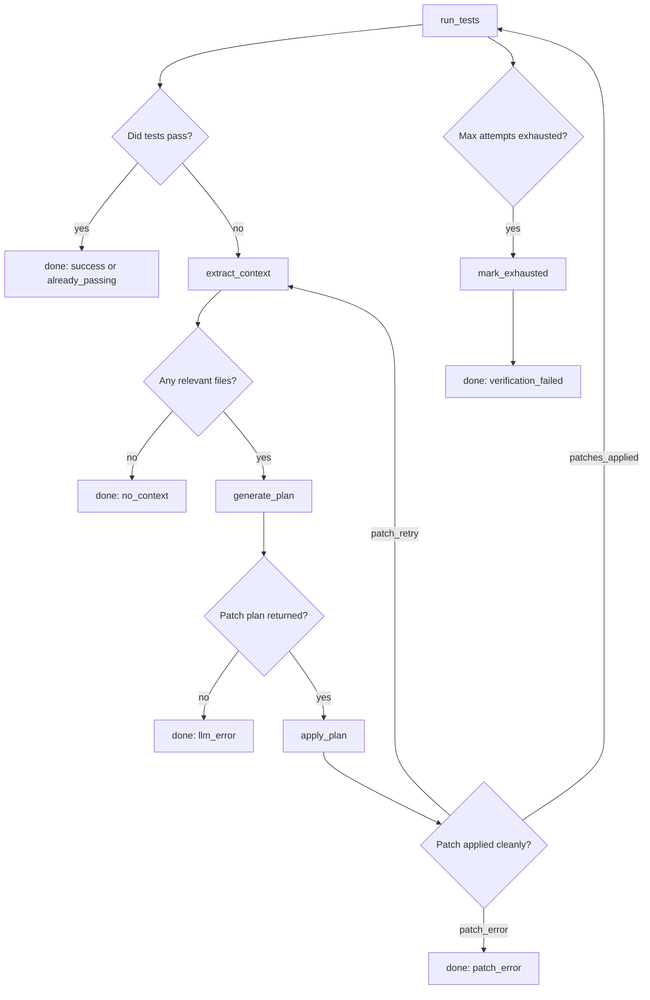

# Self-Healing CI/CD — Phase 3 (LangGraph + GitHub Action + cached Docker images)

Self-Healing CI/CD is a repo-local repair loop that turns failing test output into a verified code fix.
The project combines:

- a local CLI runner (`heal.py`)
- a LangGraph workflow (`core/workflow.py`)
- Docker-based test execution (`core/docker_runner.py`)
- AI patch generation via Anthropic
- automatic PR creation through a GitHub Action (`action.yml`)
- cached Docker environment images via `scripts/image_cache.sh` and GitHub Actions cache

The goal is simple: when CI fails, extract the failing context, ask an LLM for a patch, apply it, verify it in a fresh Docker container, and open a PR only when the fix is real.

## Why this project exists

Most failing builds still require a human to debug the test output, identify the root cause, and write a patch. This project automates that loop in a controlled way:

- it runs tests in an isolated container
- it extracts the likely failure files and surrounding context
- it asks the model for a patch plan
- it retries only a few times before stopping
- it verifies the final patch in a fresh container
- it can open a PR from GitHub Actions for the branch that failed

This keeps the repair loop focused on reproducible validation instead of blind AI edits.

## Architecture: the LangGraph repair loop



The actual graph in [core/workflow.py](core/workflow.py) is a state machine with these phases:

1. `run_tests`
2. `extract_context`
3. `generate_plan`
4. `apply_plan`
5. loop back to `run_tests` until success or the configured attempt limit is reached

This is the core “self-healing” loop: fail -> inspect -> propose -> patch -> verify -> repeat.

## How the project works end-to-end

### 1) Local CLI execution
`heal.py` is the entry point. It parses the repo path and optional flags such as:

- `--image`
- `--platform`
- `--test-cmd`
- `--setup-cmd`
- `--max-attempts`
- `--model`
- `--result-file`

It creates a `DockerTestRunner`, runs the workflow, and then writes a JSON result file if requested.

### 2) Dockerized test run
`core/docker_runner.py` does the container work:

- detects the base image automatically
- optionally bakes dependencies into a reusable image
- mounts the repo into `/app`
- runs the test command in a fresh container
- captures stdout/stderr and exit code

The dependency image is tagged as `self-heal-setup:<hash>` so it can be reused across runs.

### 3) Context extraction
`core/context_extractor.py` reads the failing test output and extracts likely relevant source files, traceback locations, and nearby file context.

### 4) Patch generation
`core/patch_generator.py` sends the failure plus context to Anthropic and asks for a structured patch plan. The patch plan is validated through Pydantic models in `core/models.py`.

### 5) Patch application
`core/patch_applier.py` applies each patch to the repo working tree using `git apply` or `patch -p1`, leaving generated patch files behind for review.

### 6) Re-run and verify
The workflow loops until:

- the tests pass
- the repo is already passing
- the max attempt count is reached
- the patch cannot be applied or no context is found

## Docker image caching behavior

The project caches the prepared test environment between GitHub Action runs.

This is implemented in:

- [action.yml](action.yml)
- [scripts/image_cache.sh](scripts/image_cache.sh)
- [core/docker_runner.py](core/docker_runner.py)

The flow is:

1. compute a cache key from:
   - base image
   - setup command
   - requirements files
   - Docker runner code itself
2. restore the matching tar.gz archive from GitHub Actions cache
3. `docker load` it onto the runner
4. run the self-healing flow
5. if no cache hit, `docker save` the image(s) and save them back to cache

This avoids rebuilding dependency-heavy Docker images on every workflow run.

## Langfuse traceability and observability

The project supports optional tracing through Langfuse so every repair run is auditable.

When `LANGFUSE_PUBLIC_KEY`, `LANGFUSE_SECRET_KEY`, and `LANGFUSE_BASE_URL` are present, `heal.py` opens a trace for each run and records metadata such as:

- run status
- exit code
- performed fix attempts
- patch application failures
- file paths touched during context extraction
- model name and repo name
- final trace URL so you can inspect it in Langfuse

The trace is intentionally metadata-only. It does not dump full prompts or repository contents, and it does not log the entire test output by default; the workflow only keeps summaries and key fields needed to understand what happened.

This makes the system useful for debugging model behavior and verifying that a failed CI run was repaired by a legitimate patch rather than an accidental or silent no-op.

> Why there is no `platform` in the action command by default: the local CLI already supports `--platform`, but the composite action interface did not expose it until this fix. The action now forwards `platform` to `heal.py`, which matters for Apple Silicon hosts or projects that need `linux/amd64` compatibility.

## 3-step Quickstart

Add this workflow to your repo and replace the example values with your project details.

```yaml
# 1) Add .github/workflows/self-heal.yml
name: Self-healing CI
on:
  workflow_run:
    workflows: ["CI"]
    types: [completed]

jobs:
  self-heal:
    if: ${{ github.event.workflow_run.conclusion == 'failure' }}
    runs-on: ubuntu-latest
    permissions:
      contents: write
      pull-requests: write
    steps:
      - uses: actions/checkout@v4

      # 2) Add the action and pass the required inputs
      - name: Heal the failing branch
        uses: your-org/self-healing-ci@v1
        with:
          test-cmd: pytest -q
          setup-cmd: pip install -r requirements.txt
          image: python:3.11
          platform: linux/amd64   # optional, useful on Apple Silicon or cross-arch builds
          anthropic-api-key: ${{ secrets.ANTHROPIC_API_KEY }}
          github-token: ${{ secrets.GITHUB_TOKEN }}
          create-pr: "true"
          cache-image: "true"

      # 3) Watch for the PR created from the self-healing branch
      # The action creates/updates a branch like self-healing/<branch>
      # and opens a PR back to the original failing branch.
```

That is the fastest way to use the action in a real repository.

## Local quickstart

### Prerequisites

| Requirement | Purpose |
|---|---|
| Python 3.10+ | run the CLI |
| Docker Desktop or a working Docker daemon | run tests in containers |
| Git | review and apply patches |
| Anthropic API key | generate fixes |

### Setup

```bash
python3 -m venv .venv
source .venv/bin/activate
pip install -r requirements.txt
cp .env.example .env
```

Then set your token:

```bash
set -a
source .env
set +a
```

Or export directly:

```bash
export ANTHROPIC_API_KEY="your_key_here"
```

### Try it against a sample repo

```bash
python3 heal.py ./sample-failing-repo --max-attempts 3
```

### Run it against your repo

```bash
python3 heal.py /path/to/your/repo --max-attempts 3
```

## GitHub Action inputs

The composite action in [action.yml](action.yml) supports these inputs:

| Input | Required | Default | Purpose |
|---|---|---|---|
| `test-cmd` | yes | | command that runs tests in the container |
| `setup-cmd` | no | empty | one-time env setup for the Docker image |
| `image` | no | empty | base Docker image |
| `max-attempts` | no | `3` | max fix attempts plus one final verification |
| `model` | no | `claude-sonnet-5-5` | Anthropic model |
| `anthropic-api-key` | yes | | API key |
| `github-token` | yes | | token for branch + PR creation |
| `branch` | no | triggering branch | target branch |
| `create-pr` | no | `true` | create a PR when fix succeeds |
| `fail-if-unhealed` | no | `true` | fail the workflow when no fix is found |
| `cache-image` | no | `true` | reuse prepared Docker images across runs |
| `langfuse-public-key` | no | empty | tracing public key |
| `langfuse-secret-key` | no | empty | tracing secret key |
| `langfuse-base-url` | no | empty | tracing host |

## Project layout

- `heal.py` — local CLI entry point
- `core/workflow.py` — LangGraph loop and routing
- `core/docker_runner.py` — isolated Docker test execution and image building
- `core/context_extractor.py` — failure context extraction
- `core/patch_generator.py` — LLM patch generation
- `core/patch_applier.py` — patch application to the repo
- `core/models.py` — patch contracts
- `action.yml` — composite GitHub Action used in CI
- `scripts/image_cache.sh` — Docker image save/load/cache logic
- `sample-*` folders — repair fixtures and regression tests

## Safety notes

- The target repo is mounted read-write while patches are applied.
- Generated patch files are left in the repo for review.
- The workflow avoids self-healing loops by skipping branches whose names start with `self-healing/`.
- The action uses GitHub Actions cache to persist the Docker environment between runs.
- You should run it against clean repos and review diffs before merging.

## Known limitations

- context extraction is regex-based and not a full parser for every test runner format
- patch application may fail if the file context has drifted
- GitHub Actions cache is best-effort and keyed to environment inputs
- LangGraph state is in-memory only for one local CLI run
- tracing is optional and metadata-only when enabled

## Running tests locally

```bash
python -m pytest -q tests
```

This project is intentionally designed to be testable without making API calls or needing a live Docker environment for the unit-level workflow tests.

## Summary

This project is a practical self-healing CI system for real repos: it fails fast, extracts context, asks for a minimal patch, verifies it in containers, and can turn a green result into a PR. The core idea is not just “AI in CI” — it is a repair loop with validation and safe review boundaries.

